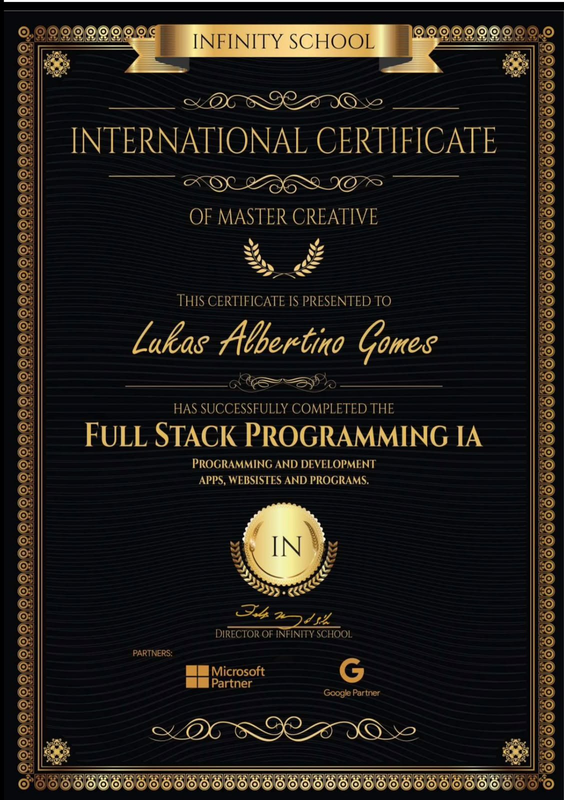

# 🐍 Exercícios Python - Infinity School

> **Repositório de estudos em Lógica de Programação e Estruturas de Dados**


## 📚 Sobre o Repositório

Este repositório contém uma coleção organizada de exercícios, desafios e projetos desenvolvidos durante o curso **PYIA | Python IA** da **Infinity School**, além de soluções de problemas de estruturas de dados do **HackerRank**.

**✅ Curso concluído: 100%**, com certificado internacional **Full Stack Programming IA**.

## 🎓 Certificado

Certificado internacional emitido pela **Infinity School**, escola parceira **Microsoft** e **Google**, pela conclusão do curso **Full Stack Programming IA**: programação e desenvolvimento de apps, sites e programas.

<p align="center">
  
</p>

## 🗂️ Estrutura do Projeto

### 📖 **Aulas/**

Exercícios e exemplos práticos das aulas:

- Cálculos geométricos (área do triângulo, trapézio)
- Manipulação de dicionários
- Funções e parâmetros
- Operações com números
- Estruturas condicionais

### 🎯 **Desafios/**

Projetos práticos e desafios avançados:

- **Sistema de Agenda** - Gerenciamento de contatos
- **Gerenciamento de Funcionários** - CRUD completo
- **Jogo de Adivinhação** - Lógica de jogos
- **Sistema de Produtos** - Banco de dados SQLite

### 💻 **HackerRank/**

Soluções de problemas de estruturas de dados e algoritmos:

- Operações aritméticas
- Diferença diagonal de matrizes
- Manipulação de strings
- Estruturas condicionais
- Algoritmos de busca
- Problemas matemáticos

### 🔍 **Algoritmos de Busca/**

- Implementação de busca binária
- Otimização de algoritmos

### 📝 **Atividades Extras/**

Exercícios complementares e práticas adicionais:

- **Atividade 1-5** - Exercícios de fixação
- **Calculadora IMC** - Aplicação prática de cálculos
- **Exercícios de Fixação** - Reforço de conceitos

### 🎯 **Projeto Final/**

Projeto completo desenvolvido como conclusão do curso:

- **Sistema de Controle de Gastos CLI** - Aplicação completa
- Gerenciamento de despesas e receitas
- Persistência de dados em CSV
- Interface de linha de comando interativa

### 📋 **Projeto Tarefas Diárias/**

Sistema CLI para gerenciar tarefas com prioridades e categorias:

- **Lista**: Armazena todas as tarefas
- **Dicionário**: Define prioridades e representa cada tarefa
- **Conjunto (Set)**: Categorias disponíveis
- **Persistência em JSON**: Dados salvos entre execuções

## 🚀 Como Usar

1. **Clone o repositório:**

   ```bash
   git clone https://github.com/lukasdevjobs1/Exercicios_praticos_InfinitySchool.git
   ```

2. **Navegue até o diretório:**

   ```bash
   cd Exercicios_praticos_InfinitySchool
   ```

3. **Execute os arquivos Python:**
   ```bash
   python nome_do_arquivo.py
   ```

## 🎯 Objetivos de Aprendizado

- ✅ Fundamentos de Python
- ✅ Lógica de Programação
- ✅ Estruturas de Dados
- ✅ Algoritmos de Busca
- ✅ Manipulação de Banco de Dados
- ✅ Resolução de Problemas
- ✅ Boas Práticas de Código

## 📊 Estatísticas do Curso

```
📊 Progresso Geral: ████████████████ 100% ✅ Concluído

📚 Estruturas de Dados:     ██████████ 100% (12/12 aulas)
🔧 Funções:                ██████████ 100% (10/10 aulas)
🖥️ Interface Gráfica:       ██████████ 100% (8/8 aulas)
🏗️ POO:                     ██████████ 100% (14/14 aulas)
🗄️ Banco de Dados:          ██████████ 100% (12/12 aulas)
🎯 Projeto Final:           ██████████ 100% (2/2 aulas)
```

## 📈 Progresso Detalhado

### 📚 **Estruturas de Dados** ✅

- [x] **Aula 1**: Listas e Tuplas (4/4) ✅
- [x] **Aula 2**: Dicionários e Sets (4/4) ✅
- [x] **Aula 3**: Revisão lógica de programação (4/4) ✅

### 🔧 **Funções e Modularização** ✅

- [x] **Aula 4**: Funções I (4/4) ✅
- [x] **Aula 5**: Funções II (4/4) ✅
- [x] **Aula 6**: Projeto Funções (2/2) ✅
- [x] **Aula 7**: Módulos e Bibliotecas (4/4) ✅
- [x] **Aula 8**: Revisão geral (4/4) ✅

### 🖥️ **Interface Gráfica** ✅

- [x] **Aula 9**: Interface Gráfica com Flet I (4/4) ✅
- [x] **Aula 10**: Interface Gráfica com Flet II (4/4) ✅

### 🏗️ **Programação Orientada a Objetos** ✅

- [x] **Aula 11**: POO I (4/4) ✅
- [x] **Aula 12**: POO II: Herança e Polimorfismo (4/4) ✅
- [x] **Aula 13**: POO III: Associação e Encapsulamento (4/4) ✅
- [x] **Aula 14**: Projeto POO e Flet (2/2) ✅

### 🗄️ **Banco de Dados** ✅

- [x] **Aula 15**: SQL I (4/4) ✅
- [x] **Aula 16**: SQL II (4/4) ✅
- [x] **Aula 17**: SQL III (4/4) ✅

### 🎯 **Projeto Final** ✅

- [x] **Aula 18**: Projeto Python (2/2) ✅

## 👨‍💻 Perfil GitHub

### Repositórios Principais:

- [Portfólio](https://lukasdevjobs1.github.io/profile-chat/) - Projetos, tecnologias e assistente de IA
- [Profile-chat](https://github.com/lukasdevjobs1/profile-chat) - Código do portfólio
- [Git_Projects](https://github.com/lukasdevjobs1/Git_Projects) - Portfólio técnico
- [Exercicios_praticos_InfinitySchool](https://github.com/lukasdevjobs1/Exercicios_praticos_InfinitySchool) - Este repositório

### Stack Tecnológica:

- Frontend: HTML5/CSS3, JavaScript ES6+, TypeScript
- Backend: Python, Node.js, SQLite
- Cloud/Deploy: GitHub Pages, Vercel, AWS (básico)

## 📧 Contato

- Email: luk.devjobs@gmail.com
- LinkedIn: [Lukas Gomes](https://www.linkedin.com/in/lukas-gomes-4470a2269/)
- WhatsApp: [+55 85 99257-0216](https://wa.me/5585992570216)

**🎓 Instituição:** Infinity School · Curso concluído com certificado internacional
**📅 Última Atualização:** Outubro 2026

